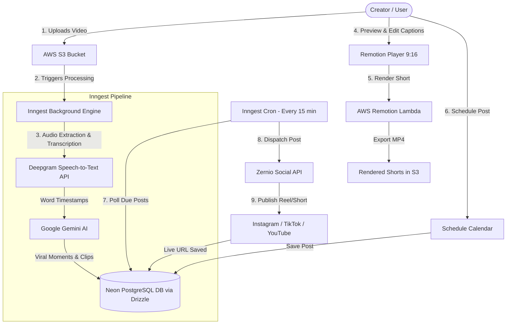

# VidShorts AI — Long-to-Short Video Automation Studio

> Turn long-form videos into high-engagement viral shorts (9:16) with AI-powered moment detection, animated dynamic captions, Remotion cloud rendering, and automated multi-platform social media scheduling.

[](https://nextjs.org/)
[](https://react.dev/)
[](https://www.typescriptlang.org/)
[](https://orm.drizzle.team/)
[](https://neon.tech/)
[](https://www.inngest.com/)
[](https://www.remotion.dev/)
[](https://clerk.com/)
[](https://arcjet.com/)

---

## 📋 Table of Contents

- [Overview](#overview)
- [Key Features](#key-features)
- [System Architecture](#system-architecture)
- [Tech Stack](#tech-stack)
- [Project Structure](#project-structure)
- [Getting Started](#getting-started)
  - [Prerequisites](#prerequisites)
  - [Environment Variables](#environment-variables)
  - [Installation & Database Setup](#installation--database-setup)
  - [Running Locally](#running-locally)
- [Core Workflows](#core-workflows)
  - [1. Video Ingestion & Processing Pipeline](#1-video-ingestion--processing-pipeline)
  - [2. Remotion Video Generation & Preview](#2-remotion-video-generation--preview)
  - [3. Scheduled Social Media Auto-Publisher](#3-scheduled-social-media-auto-publisher)
- [API Routes Reference](#api-routes-reference)
- [Contributing & License](#contributing--license)

---

## 🚀 Overview

**VidShorts AI** is a production-grade full-stack video automation studio built with Next.js 15, React 19, and Drizzle ORM. It enables creators, podcasters, and content teams to upload hours of long-form video footage (podcasts, webinars, interviews, YouTube videos) and automatically extract the most viral segments, format them for TikTok, Instagram Reels, and YouTube Shorts (9:16 aspect ratio), overlay karaoke-style animated captions, and schedule them across connected social platforms on autopilot.

---

## ✨ Key Features

### 🎬 AI Long-to-Short Transformation
- **Deepgram Nova-2 Audio Transcription:** Transcribes multi-hour video audio with exact word-level millisecond timestamps.
- **Gemini AI Viral Detection:** Analyzes the semantic structure of the transcript to detect hooks, punchlines, emotional highs, and high-retention segments (20–90 seconds) with virality scoring (1–100).
- **Automated Clip Generation:** Creates individual short clips with custom titles, virality scores, and reasoning.

### 🎨 Remotion Video Engine & Dynamic Captions
- **Real-Time Web Player:** Built on `@remotion/player` for instant client-side preview in 9:16 vertical orientation.
- **Customizable Caption Styles:** Multiple animated typography presets (Hormozi, Devin, Neon, Minimal, Highlight) with custom font weights, text strokes, and active-word animations.
- **Cloud Rendering via Remotion Lambda:** Renders final high-bitrate MP4s directly on AWS Lambda or falls back to local render workers.

### 📅 Smart Content Scheduling Calendar
- **Interactive Calendar View:** Browse posts by day, week, or month with real-time status badges.
- **Past-Date Prevention:** Guardrails preventing accidental scheduling into past dates/times.
- **Post Inspection Modal:** Click on any calendar entry to watch the video clip, inspect captions, view target social platforms, and copy descriptions.
- **Color-Coded Statuses:** Visually distinguishes pending scheduled posts from published content with direct links to live social posts.

### 🤖 Autopilot Social Media Dispatch (Zernio + Inngest)
- **Multi-Platform Publishing:** Post directly to Instagram Reels, TikTok, YouTube Shorts, Facebook Reels, and LinkedIn via the **Zernio API**.
- **Automated Cron Jobs:** An Inngest background function runs every 15 minutes (`schedule-posts-cron`), finds due scheduled posts, dispatches media to Zernio, and marks them published.
- **Social Account Connections:** Dedicated dashboard to connect and manage platform accounts and API keys.

### 🛡️ Enterprise-Grade Security & Auth
- **Clerk Authentication:** Seamless social and email authentication with user profile synchronization.
- **Arcjet AI & Rate Limiting:** Rate limiting (e.g., max 2 video generations/day per free user), bot protection, and AI endpoint shielding.

### 📁 Project Management & "My Videos"
- **Unified Media Library:** Browse all uploaded long-form videos with clip counters, processing states, and direct links to generated clips.
- **Project Detail View:** Re-analyze, edit individual short clips, re-render, and schedule directly.

---

## 🏗️ System Architecture



---

## 🛠️ Tech Stack

| Layer | Technologies |
|---|---|
| **Framework** | [Next.js 15 (App Router)](https://nextjs.org), [React 19](https://react.dev) |
| **Language** | [TypeScript](https://www.typescriptlang.org/) |
| **Styling** | [Tailwind CSS](https://tailwindcss.com), Radix UI, Lucide Icons |
| **Database** | [Neon Serverless PostgreSQL](https://neon.tech) |
| **ORM** | [Drizzle ORM](https://orm.drizzle.team) |
| **Authentication** | [Clerk](https://clerk.com) |
| **Video Engine** | [Remotion](https://www.remotion.dev) (`@remotion/player`, `@remotion/lambda`) |
| **AI Transcription** | [Deepgram Nova-2](https://deepgram.com) |
| **LLM Analysis** | [Google Gemini 2.5 Flash / 3.8 Flash](https://ai.google.dev) |
| **Workflow Engine** | [Inngest](https://www.inngest.com) (Event-driven jobs & crons) |
| **Social Distribution**| [Zernio API](https://docs.zernio.com) (Instagram, TikTok, YouTube Shorts) |
| **File Storage** | [AWS S3](https://aws.amazon.com/s3/) |
| **Security & Limits** | [Arcjet](https://arcjet.com) (Bot shield, prompt injection, rate limit) |

---

## 📂 Project Structure

```
vidshorts-long-to-short-video/
├── app/
│   ├── api/
│   │   ├── inngest/               # Inngest API endpoint & workflow handlers
│   │   ├── projects/              # Projects CRUD & streaming analysis
│   │   ├── schedule/              # Schedule posts CRUD, AI captions & dispatch
│   │   ├── shorts/                # Shorts retrieval & Remotion rendering
│   │   └── zernio/                # Social connections, auth callback, API key save
│   ├── dashboard/
│   │   ├── layout.tsx             # Dashboard shell with sidebar & header
│   │   ├── my-videos/             # Video uploads management gallery
│   │   ├── project/[id]/          # Project detail: clips list, player & editor
│   │   ├── schedule/              # Interactive content calendar
│   │   ├── social-connections/    # Connected platforms manager
│   │   └── settings/              # User preferences
│   ├── layout.tsx                 # Root layout with ClerkProvider
│   └── page.tsx                   # Landing page with hero, features & pricing
├── components/
│   ├── dashboard/                 # Dashboard widgets, modals, upload hero
│   ├── remotion/                  # Remotion ShortVideoComposition & Player
│   ├── landing/                   # Landing page sections
│   └── ui/                        # Radix UI + Tailwind primitives
├── config/
│   ├── caption-styles.ts          # Preset styles (Hormozi, Beast, Devin, Neon)
│   └── shorts.config.ts           # Video length, aspect ratio & model config
├── db/
│   ├── index.ts                   # Drizzle client initialized with Neon
│   ├── schema.ts                  # Database schemas: users, projects, clips, posts
│   └── scheduled-posts.ts         # Queries for scheduled & published posts
├── drizzle/                       # Generated SQL migrations
├── lib/
│   ├── arcjet.ts                  # Rate limiting & security rules
│   ├── aws/s3.ts                  # S3 upload & presigned URL utilities
│   ├── inngest/                   # Client & background functions
│   │   ├── functions.ts           # Video processing pipeline
│   │   └── schedule-post.ts       # 15-minute cron social publisher
│   ├── remotion/                  # Lambda rendering & worker logic
│   ├── transcription.ts           # Deepgram audio transcription
│   ├── gemini.ts                  # Gemini prompt & viral segment extractor
│   └── zernio.ts                  # Zernio API client for social publishing
├── remotion/
│   ├── Root.tsx                   # Remotion composition registry
│   └── index.ts                   # Remotion bundle entrypoint
└── package.json
```

---

## ⚡ Getting Started

### Prerequisites

Ensure you have the following installed:
- [Node.js](https://nodejs.org/) (v18.18.0 or later recommended)
- `npm` or `pnpm`
- Git

### Environment Variables

Copy the example environment file:
```bash
cp .env.example .env.local
```

Fill in your API credentials in `.env.local`:

```env
# Clerk Authentication
NEXT_PUBLIC_CLERK_PUBLISHABLE_KEY=pk_test_...
CLERK_SECRET_KEY=sk_test_...
NEXT_PUBLIC_CLERK_SIGN_IN_URL=/sign-in
NEXT_PUBLIC_CLERK_SIGN_UP_URL=/sign-up
NEXT_PUBLIC_CLERK_SIGN_IN_FALLBACK_REDIRECT_URL=/dashboard
NEXT_PUBLIC_CLERK_SIGN_UP_FALLBACK_REDIRECT_URL=/dashboard

# Neon PostgreSQL Database
DATABASE_URL=postgresql://[user]:[password]@[neon_hostname]/[dbname]?sslmode=require

# AWS S3 Storage
AWS_REGION=us-east-1
AWS_ACCESS_KEY_ID=your-aws-access-key-id
AWS_SECRET_ACCESS_KEY=your-aws-secret-access-key
AWS_BUCKET_NAME=your-s3-bucket-name

# Inngest Background Engine
INNGEST_EVENT_KEY=your-inngest-event-key
INNGEST_SIGNING_KEY=your-inngest-signing-key

# Deepgram AI Speech-to-Text
DEEPGRAM_API_KEY=your-deepgram-api-key

# Google Gemini AI
GEMINI_API_KEY=your-gemini-api-key
GEMINI_MODEL=gemini-2.5-flash

# Arcjet Security & Rate Limiting
ARCJET_KEY=ajkey_your_arcjet_key_here
ARCJET_ENV=development

# Remotion Lambda (Optional for AWS Cloud Rendering)
REMOTION_AWS_ACCESS_KEY_ID=your-remotion-aws-access-key-id
REMOTION_AWS_SECRET_ACCESS_KEY=your-remotion-aws-secret-access-key
REMOTION_AWS_REGION=us-east-1
REMOTION_FUNCTION_NAME=remotion-render-...
REMOTION_BUCKET_NAME=your-remotion-bucket

# Zernio Social Media Publishing
ZERNIO_API_KEY=your-zernio-api-key
```

### Installation & Database Setup

1. Install project dependencies:
   ```bash
   npm install
   ```

2. Run database migrations with Drizzle:
   ```bash
   npm run db:push
   # or
   npx drizzle-kit push
   ```

### Running Locally

To run the application with full background workflow support:

1. **Start the Next.js development server:**
   ```bash
   npm run dev
   ```
   Open [http://localhost:3000](http://localhost:3000) in your browser.

2. **Start the Inngest local dev server** (in a separate terminal):
   ```bash
   npx inngest-cli@latest dev
   ```
   Open the Inngest Dev Dashboard at [http://localhost:8288](http://localhost:8288) to inspect background functions and simulate cron triggers.

---

## 🔄 Core Workflows

### 1. Video Ingestion & Processing Pipeline
1. User uploads an MP4/MOV file from the **Dashboard Upload Hero**.
2. File streams to AWS S3, returning a persistent asset key.
3. Next.js triggers the Inngest event `project/video.uploaded`.
4. Inngest executes steps:
   - **Extract Audio & Transcribe:** Calls Deepgram with word timestamps.
   - **Analyze with Gemini AI:** Segments speech into high-retention clips (20–90s), scores virality, and creates captions.
   - **Persist Clips:** Saves clips into Neon DB linked to the user's project.

### 2. Remotion Video Generation & Preview
1. User selects a clip in `/dashboard/project/[id]`.
2. Remotion Player mounts client-side, dynamically syncing captions to playback time.
3. User selects caption theme (Hormozi, Devin, Neon, Minimal).
4. Clicking **Render Short** triggers Remotion Lambda on AWS, returning an S3 link to the rendered vertical MP4.

### 3. Scheduled Social Media Auto-Publisher
1. From the **Calendar** or **Project Detail**, user picks a future date/time, social platforms (Instagram, TikTok, YouTube), and writes an AI-assisted caption.
2. The post is saved in `scheduled_posts` with `status: "scheduled"`.
3. Inngest function `schedule-posts-cron` runs every 15 minutes:
   - Queries posts where `scheduledAt <= NOW() + 15 min` and `status == "scheduled"`.
   - Sends the video URL, caption, and accounts to **Zernio API** (`/v1/posts`).
   - Receives post ID and live platform URL (e.g., `https://www.instagram.com/reel/...`).
   - Updates post status to `"published"` and records the live URL.

---

## 📡 API Routes Reference

| Method | Endpoint | Description |
|---|---|---|
| `GET / POST` | `/api/inngest` | Inngest webhook endpoint for background jobs and cron triggers |
| `GET / POST` | `/api/projects` | List all user projects (with clip counts) and create new projects |
| `GET / DELETE` | `/api/projects/[id]` | Fetch single project with clips or delete a project |
| `POST` | `/api/projects/[id]/analyze` | Re-run AI analysis on an existing project |
| `POST` | `/api/shorts/[id]/render` | Trigger Remotion cloud render for a clip |
| `GET / POST` | `/api/schedule/posts` | List scheduled posts for calendar / schedule a new post |
| `GET / DELETE` | `/api/schedule/posts/[id]`| Get post details or cancel a scheduled post |
| `POST` | `/api/schedule/dispatch` | Force dispatch due posts to social media |
| `POST` | `/api/schedule/ai-generate` | Generate viral social captions with hashtags using AI |
| `POST` | `/api/zernio/save-key` | Save or update user Zernio API key |
| `GET` | `/api/zernio/status` | Check Zernio connection status and connected platforms |

---

## 📄 License

This project is licensed under the MIT License — see the [LICENSE](LICENSE) file for details.
